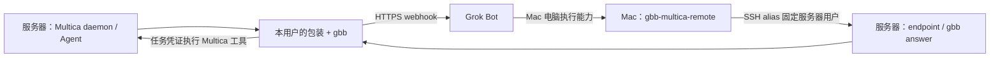

# Grok Bot Bridge × Multica

让 Linux 服务器上的 Multica Agent 把任务交给 Grok Bot，并把回答与 Multica 查询、创建、编辑结果带回聊天。Mac 运行 Grok Bot 客户端，使用已有 SSH 连接把答案写回正确的服务器用户。

当前包装版本 **0.3.0**，固定安装随仓库提供的 **gbb 0.2.0**。仓库先保持私有；安装需要有权限的 GitHub 登录。



不需要 HTTP 入站服务或公网隧道。服务器要能访问 webhook；Mac 要能通过 SSH 访问服务器。Bot 的电脑执行能力也必须具备这条 SSH 访问能力。

## 多用户：要不要多个 Bot？

**不强制一人一个 Bot。建议按用户/实例分别命名，独立使用时也分别创建 Bot 和 webhook。** 共用 Bot 时，必须按请求的 `reply_route` 回填。

| 配置层 | 作用 | 多用户怎么处理 |
| --- | --- | --- |
| Linux 系统用户 | 文件权限、HOME、进程身份 | 各自运行自己的 daemon，保存自己的 gbb 配置与消息 |
| Multica 登录 profile | 当前登录账号/工作区与本机配置 | 各系统用户可都用 `default`；需要命名配置时传 `--profile` |
| Custom runtime profile | 包装的启动协议与命令定义 | 同一工作区可复用 `Grok Bot Bridge` 定义；本机路径按 daemon 账号配置 |
| Runtime | 某个 daemon 实际发现的运行目标 | 安装脚本同时匹配 profile ID、当前 daemon ID 和 online 状态 |
| Agent | 用户在 Multica 中聊天和执行任务的对象 | 每个实例使用独立名称，绑定自己的 runtime、GBB_HOME、实例和路由 |
| Grok Bot / webhook | 接收任务并产生回复 | 可共用；分开更便于查看、限流和维护，不能用名称代替路由校验 |
| Mac 回填路由 | 映射到 SSH 用户和服务器实例 | 每个实例一个固定 route，例如 `linux-alice`、`linux-bob` |

多个命名 profile 不等于操作系统隔离。此安装器按**每个 Linux 用户一个 gbb 实例**设计；同一用户要切换实例时会停止并提示核对。账号之间需要权限隔离时，使用独立系统用户、容器或 VM。共用 Bot/同一 Mac 的电脑执行权限也意味着共享一部分访问能力，Bot 名称本身不提供隔离。

## 准备条件

- 服务器：Linux、Python 3.9+、Node.js 20+ 与 npm；已安装 Multica CLI，并以实际 daemon 用户登录目标工作区、启动 daemon。已验证 Multica CLI 0.6.3、Node 22.22.0。
- Mac：Python 3.9+、系统 SSH 客户端、Grok Bot 客户端及电脑执行能力。Mac 不必安装 Multica 或本地 gbb。
- SSH 已配置好用户、主机密钥校验及非交互登录；安装器使用 `BatchMode=yes`，不会替你修改服务器 `authorized_keys` 或关闭主机密钥校验。
- GitHub 私有仓库读取权限。每台机器可用 `gh repo clone lthero-big/gbb-multica-bridge`，或用已配置凭证的 `git clone`。

## 快速开始

### 1. 两台机器分别取代码

```bash
gh repo clone lthero-big/gbb-multica-bridge
cd gbb-multica-bridge
```

私有仓库使用认证 clone，不采用匿名的 raw URL 或 `curl | bash`。

### 2. 准备 Bot 的 webhook

在 Mac 的 Grok Bot 中复用已有 Bot，参考 [Bot 提示词](docs/grok-bot-prompt.md) 创建或更新 webhook routine。按用户命名，例如 `bridge-linux-alice`。从 routine 面板取得 URL/key，下一步在服务器终端交互输入。已有 Bot、URL/key 不需要重新创建。

### 3. 服务器一键安装

在 **daemon 用户的普通登录终端**执行，不要在 Multica agent 任务终端执行安装：

```bash
bash install.sh server --instance-id linux-alice --bot bridge-linux-alice
```

使用命名的 Multica 登录配置或指定工作区时：

```bash
bash install.sh server \
  --instance-id linux-alice \
  --bot bridge-linux-alice \
  --profile alice \
  --workspace-id 实际工作区UUID
```

脚本校验本地归档、离线安装 gbb 0.2.0 到当前用户目录、复用或交互保存 URL/key、安装包装与 SSH endpoint、注册或复用 runtime profile 和 Agent。不需要修改脚本；不会创建 Grok Bot、发送 Grok 请求或安装其他 CLI 的技能。URL/key 不出现在命令参数里。

默认 Agent 名称为 `Grok Bot Bridge · linux-alice`。可用 `--agent-name` 指定，升级现有测试 Agent 时请显式传其原名。先结束该 Agent 正在运行的请求；安装脚本会拒绝修改仍有任务的 Agent。

### 4. Mac 一键配置回填

例如 `~/.ssh/config` 已有如下别名，先自行确认 `ssh multica-alice` 能登录：

```sshconfig
Host multica-alice
    HostName your-server.example
    User alice
    IdentityFile ~/.ssh/id_ed25519_multica_alice
    IdentitiesOnly yes
```

然后执行：

```bash
bash install.sh mac --route linux-alice --ssh-alias multica-alice --bot bridge-linux-alice
```

脚本通过 SSH 发现 endpoint 的绝对路径，检查服务器实例、gbb 版本和凭证可读状态，再安装 Mac 回填助手、保存路由并生成实际 Bot 提示词。将生成的 `~/.config/gbb-multica/grok-bot-prompt.md` 给对应 Bot，确认其电脑执行能力可以调用这个助手。

默认 route 与实例名相同。若服务器显式设置了不同的 `--reply-route`，Mac 需同时传 `--route 回填路由名 --instance-id 服务器实例名`，两者不可混用。

SSH 只会返回配置检查结果；不会把服务器的 webhook key 或 Multica token 复制到 Mac。若服务器 endpoint 不在默认目录，可加 `--endpoint /实际绝对路径/gbb-multica-endpoint`。

### 5. 验证完整问答

在 Multica 新开该 Agent 的聊天，只发一次：

> 请只回复 `GBB_RUNTIME_OK`。

Grok 根据本轮 `next`，在 Mac 执行类似下列命令（使用生成提示词中的实际助手路径）：

```bash
"$HOME/.local/bin/gbb-multica-remote" answer linux-alice 本轮消息ID - <<'GBB_REPLY'
GBB_RUNTIME_OK
GBB_REPLY
```

Multica 显示回答、运行成功结束，才代表完整打通。仅 `--check` 成功不能证明 Bot 电脑执行能力已经可用。之后可发送“列出当前工作区项目”；创建/编辑操作应明确描述目标及字段，由服务器包装使用该任务的身份执行。

## 我们的实际场景示例

工作区是“土卫五”，一台 Linux 服务器运行 Multica daemon，Mac 登录 Grok Bot，已有 Bridge webhook。服务器账号使用默认 Multica 登录配置，**不需要 `alex` 或 `alex_wan` profile**。可以选择实例名 `linux-root`：

```bash
# 服务器 root 的普通终端；已有 bridge 凭证可直接复用
bash install.sh server --instance-id linux-root --bot bridge \
  --agent-name 'Grok Bot Bridge 测试'

# Mac；multica-root 是你自己配置好的 SSH alias，User 为 root
bash install.sh mac --route linux-root --ssh-alias multica-root --bot bridge
```

这里只公开场景及可替换名称，没有真实服务器地址、工作区 UUID、用户邮箱、访问凭证或运行日志。服务器不是 root 时，使用实际 daemon 用户，不要复制 `/root/.grok-bot-bridge` 路径或放宽 `/root` 权限。

同一服务器再增加 alice、bob 时，各自使用独立 Linux 登录和 daemon，并分别运行 server 安装；Mac 分别添加 `linux-alice → multica-alice`、`linux-bob → multica-bob` 两条 route。可以共用 `bridge` Bot，也可分别使用 `bridge-linux-alice`、`bridge-linux-bob`；脚本会合并保留已有路由。

## 检测、升级及手动回填

```bash
# 两种模式都支持纯展示：不写文件、不连接网络
bash install.sh server --dry-run
bash install.sh mac --dry-run

# 已安装后只读检查
bash install.sh server --check
bash install.sh mac --route linux-alice --check
"$HOME/.local/bin/gbb-multica-remote" check linux-alice
"$HOME/.local/bin/gbb-multica-remote" inbox linux-alice
```

升级时拉取代码后重跑原安装命令。修改过的本地文件会先备份，已有资源会复用，不会自动发送测试消息。`--check` 返回 2 表示 Multica 配置尚需修正，其他非零状态说明检查/权限/连接失败。

先手动验证也可以：在服务器同一用户及同一 GBB_HOME 下运行 `gbb inbox`，将 Grok 的真实回答用 `gbb answer 本轮消息ID -` 回填。此时无需 Mac→SSH 自动回填。固定安装的 gbb 位于 `~/.local/share/gbb-multica/npm/bin/gbb`；可直接用绝对路径。默认整次任务等待 900 秒，最多 8 次 Grok 请求；旧任务超时后补写答案不会重新启动它。

更多工具能力、回填 JSON、权限边界见 [工具协议与操作说明](docs/tool-protocol.md)。

## 目录与版本来源

| 路径 | 内容 |
| --- | --- |
| `install.sh` / `install.py` | Linux / macOS 安装入口 |
| `gbb-multica-agent` | Copilot JSONL 协议的 Multica runtime 包装 |
| `gbb-multica-setup.sh` | 可独立运行的 runtime/Agent 注册脚本，内嵌同版本包装 |
| `gbb-multica-endpoint` | 服务器固定的 check/inbox/answer 入口 |
| `gbb-multica-remote` | Mac 路由与 SSH 回填助手 |
| `vendor/` | 固定 gbb 0.2.0 安装包、校验值和上游许可证 |

gbb 0.2.0 安装包是从本机已安装、通过联调的程序执行 `npm pack --ignore-scripts` 取得，**不声称是 npm 官方 0.2.0 发布归档**。它含编译后的 JS、示例和文档，没有运行时 npm 依赖，也不含本机配置、凭证或消息。上游为 [anup-a/grok-bot-bridge](https://github.com/anup-a/grok-bot-bridge)，按 MIT 许可证保留归属。

## 验证

在 Linux、Node.js 20+、Python 3.9+ 环境运行：

```bash
python3 test_gbb_multica_compat.py
python3 test_gbb_multica_agent.py
python3 test_gbb_multica_setup.py
python3 test_gbb_multica_install.py
# 下列工具测试还需要已安装的 Multica CLI，用于实际 --help 参数契约；业务读写为隔离模拟
python3 -m unittest -v test_gbb_multica_tools.py
```

测试使用环回 webhook、临时 gbb 目录、模拟 Multica API 和 SSH；不发生产 Grok 请求、不改业务资源。Mac 安装及路由逻辑通过模拟 Darwin/SSH 覆盖；实际 Mac 客户端授权和真实 SSH 环境仍需部署后完成第 5 步验收。
