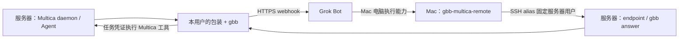

# Grok Bot Bridge × Multica

让 Linux 服务器上的 Multica Agent 把任务交给 Grok Bot，并把回答与 Multica 查询、创建、编辑结果带回聊天。Mac 运行 Grok Bot 客户端，使用已有 SSH 连接把答案写回正确的服务器用户。

当前包装版本 **0.3.0**，固定安装随仓库提供的 **gbb 0.2.0**。仓库先保持私有；安装需要有权限的 GitHub 登录。



不需要 HTTP 入站服务或公网隧道。服务器要能访问 webhook；Mac 要能通过 SSH 访问服务器。Bot 的电脑执行能力也必须具备这条 SSH 访问能力。

## 多用户：要不要多个 Bot？

**不强制一人一个 Bot。建议按用户/实例分别命名，独立使用时也分别创建 Bot 和 webhook。** 共用 Bot 时，必须按请求的 `reply_route` 回填。

| 配置层 | 作用 | 多用户怎么处理 |
| --- | --- | --- |
| Linux 系统用户 | 文件权限、HOME、进程身份 | 各自运行自己的 daemon，保存自己的 gbb 配置与消息 |
| Multica 登录 profile | 当前登录账号/工作区与本机配置 | 各系统用户可都用 `default`；需要命名配置时传 `--profile` |
| Custom runtime profile | 包装的启动协议与命令定义 | 同一工作区可复用 `Grok Bot Bridge` 定义；本机路径按 daemon 账号配置 |
| Runtime | 某个 daemon 实际发现的运行目标 | 安装脚本同时匹配 profile ID、当前 daemon ID 和 online 状态 |
| Agent | 用户在 Multica 中聊天和执行任务的对象 | 每个实例使用独立名称，绑定自己的 runtime、GBB_HOME、实例和路由 |
| Grok Bot / webhook | 接收任务并产生回复 | 可共用；分开更便于查看、限流和维护，不能用名称代替路由校验 |
| Mac 回填路由 | 映射到 SSH 用户和服务器实例 | 每个实例一个固定 route，例如 `linux-alice`、`linux-bob` |

多个命名 profile 不等于操作系统隔离。此安装器按**每个 Linux 用户一个 gbb 实例**设计；同一用户要切换实例时会停止并提示核对。账号之间需要权限隔离时，使用独立系统用户、容器或 VM。共用 Bot/同一 Mac 的电脑执行权限也意味着共享一部分访问能力，Bot 名称本身不提供隔离。

## 准备条件

- 服务器：Linux、Python 3.9+、Node.js 20+ 与 npm；已安装 Multica CLI，并以实际 daemon 用户登录目标工作区、启动 daemon。已验证 Multica CLI 0.6.3、Node 22.22.0。
- Mac：Python 3.9+、系统 SSH 客户端、Grok Bot 客户端及电脑执行能力。Mac 不必安装 Multica 或本地 gbb。
- SSH 可以使用已有免密 alias，也可以在 Mac 安装时加 `--setup-ssh`，通过一次密码登录追加公钥。首次配置要求目标账号允许密码认证，并使用 `~/.ssh/authorized_keys` 授权公钥；后续回填使用 `BatchMode=yes`。
- GitHub 私有仓库读取权限。每台机器可用 `gh repo clone lthero-big/gbb-multica-bridge`，或用已配置凭证的 `git clone`。

## 安装参数说明

`server` 和 `mac` 是运行模式，分别在 Linux 服务器和 Grok Bot 所在 Mac 执行。下文的 `alice` 只是示例，不要求创建一个叫 alice 的系统用户、Multica 登录配置或 Bot。先阅读参数含义，再替换成自己的名称。

### 服务器参数

| 参数 | 用途与填写方式 | 不填时的行为 |
| --- | --- | --- |
| `--instance-id linux-alice` | 给“这台服务器上的这个用户的 gbb 部署”起一个稳定标识。可自定，如 `linux-root`、`server-bob`；不是账号、工作区 ID 或 Bot ID。建议带上服务器和用户，便于区分。 | 重用上次实例名；首次按“主机短名-当前用户名”生成。已有实例后不能直接用另一个名字重装。 |
| `--bot bridge-linux-alice` | gbb 保存这组 webhook URL/key 的本地名称，同时作为请求目标。建议与实际 Grok Bot 的名称一致；已有配置名为 `bridge` 时就填 `bridge`。此参数不会创建或重命名 Grok Bot。 | 重用上次名称；首次交互询问，建议值为 `bridge-实例名`。 |
| `--profile alice` | 选择**已经存在且已登录的 Multica 登录配置**。与平时执行 `multica --profile alice ...` 的含义相同；不是 Linux 用户名，也不是自动注册的 custom runtime profile。 | 重用上次选择；首次使用 CLI 当前登录配置。本机使用默认登录配置，可直接省略。 |
| `--workspace-id 实际工作区UUID` | 指定 Agent/runtime 所属工作区的真实 UUID。从 `multica workspace get --output json` 返回的 `id` 获取；不能填工作区名称或照抄“实际工作区UUID”。 | 重用上次工作区；首次读取所选 Multica 登录配置的当前工作区。 |
| `--reply-route linux-alice` | 告诉 Grok 将答案交给 Mac 上哪条回填路由。必须与 Mac 安装命令的 `--route` 相同。 | 重用上次路由；首次与 `--instance-id` 相同，通常不用单独指定。 |
| `--agent-name 'Grok Bot Bridge 测试'` | 在 Multica 中创建或复用的 Agent 名称。名称含空格时加引号；要升级已有 Agent，就填其原名。 | 重用上次名称；首次为 `Grok Bot Bridge · 实例名`。 |
| `--gbb-home /home/alice/.grok-bot-bridge` | 当前 daemon 用户的 gbb 数据目录，保存配置、凭证、消息等。应是该用户自己的目录。 | 重用上次目录；首次为该用户的 `~/.grok-bot-bridge`。 |

首次使用默认登录配置和当前工作区时，只需指定易识别的实例名与现有 Bot 名称：

```bash
bash install.sh server --instance-id linux-alice --bot bridge-linux-alice
```

只有你平时确实使用命名的 Multica 登录配置时，才加 `--profile`。要确认工作区，可以在服务器的普通登录终端运行：

```bash
# 默认登录配置的当前工作区；读取结果中的 id
multica workspace get --output json

# 若平时使用名为 alice 的登录配置，查询该配置的工作区
multica --profile alice workspace get --output json
```

### Mac 参数

| 参数 | 用途与填写方式 | 不填时的行为 |
| --- | --- | --- |
| `--route linux-alice` | Mac 上这条 SSH 回填路径的名称，必须与服务器的 `--reply-route` 相同；服务器未显式设置 reply-route 时，就是其 instance-id。 | 也可用 `--instance-id` 提供同名路由；两者均未传时交互询问，非交互模式报错。 |
| `--ssh-alias multica-alice` | 要使用的 **Host 别名**。普通模式使用 Mac `~/.ssh/config` 中已有的别名；加 `--setup-ssh` 时自动配置专用别名。对应的 `User` 必须是服务器实际运行 daemon 的系统用户。 | 重用这条路由上次的 alias；普通新路由会询问；setup-ssh 模式默认 `multica-路由名`。 |
| `--setup-ssh` | 首次安装时自动生成/复用密钥，通过一次密码登录向目标账号追加公钥，验证免密后继续配置回填路由。 | 使用已有 SSH alias，不修改公钥配置。不能与只读 `--check` 同用。 |
| `--ssh-host your-server.example` | setup-ssh 模式的服务器域名/IP，只填地址，不含用户名、协议或端口。 | 复用这条路由上次的服务器地址；首次交互询问。 |
| `--ssh-user alice` | setup-ssh 模式的服务器系统用户，必须与 daemon 用户一致；不是 Multica profile。 | 复用上次用户；首次交互询问。 |
| `--ssh-port 22` | setup-ssh 模式的 SSH 端口，范围 1–65535。例如服务器端口为 2222，就填 `--ssh-port 2222`。 | 复用上次端口；首次为 22。 |
| `--ssh-key "$HOME/.ssh/id_ed25519"` | setup-ssh 模式使用的 **Mac 私钥**路径，相当于 `ssh -i` 选择的身份。已有文件会复用；不存在时生成 Ed25519 密钥对。 | 复用上次私钥路径；首次为 `~/.ssh/gbb_multica_别名_ed25519`。私钥留在 Mac，只复制公钥。 |
| `--bot bridge-linux-alice` | 生成 Bot 提示词时使用的名称标注。建议与服务器 `--bot` 保持一致；它不负责选择 SSH 账号或校验 webhook。 | 重用这条路由上次的名称；首次为 `bridge-实例名`。已有 Bot 叫 `bridge` 时请显式传 `--bot bridge`。 |
| `--instance-id linux-alice` | 服务器的真实部署标识，用于检查是否连接了正确实例。仅在 route 名与服务器实例名不同等情况下需要单独填写。 | 重用这条路由上次的实例名；首次与 `--route` 相同。 |
| `--endpoint /home/alice/.local/bin/gbb-multica-endpoint` | SSH 登录服务器后要执行的回填入口的**服务器绝对路径**。不要填 Mac 路径。 | 重用上次路径；新路由通过 SSH 自动发现远端 `~/.local/bin/gbb-multica-endpoint`，通常不用填。 |

例如 Mac 的 SSH 配置是：

```sshconfig
Host multica-alice
    HostName your-server.example
    User alice
```

那么 `--ssh-alias` 填 `multica-alice`；`alice` 是 SSH 登录的系统用户。它恰好与某个 Multica profile 同名也只是命名选择，两者独立。完整 SSH 密钥示例见后面的快速开始。

`--ssh-host`、`--ssh-user`、`--ssh-port`、`--ssh-key` 仅用于 Mac 的 `--setup-ssh` 模式。专用配置保存在 Mac 的 `~/.ssh/gbb-multica/别名.conf`，回填助手自动带 `ssh -F` 使用它；原有 `~/.ssh/config` 会保留。

### 两端怎样对应

| 服务器设置 | Mac 设置 | 对应规则 |
| --- | --- | --- |
| `--instance-id linux-alice`，省略 reply-route | `--route linux-alice` | 最常用；route、实例名均为 `linux-alice`。 |
| `--instance-id linux-alice --reply-route alice-reply` | `--route alice-reply --instance-id linux-alice` | 自定义路由名时，路由对应路由、实例对应实例。 |
| `--bot bridge-linux-alice` | `--bot bridge-linux-alice` | 保持提示词标注一致；回填目标由 route 决定。 |
| 以 Linux 用户 `alice` 运行 daemon/安装 | SSH alias 对应 `User alice` | 必须进入同一系统用户，才能读写同一套 gbb 消息。 |

实例名、route 和 SSH alias 只能包含字母、数字、点、下划线和连字符，长度 1–80；名称须以字母或数字开头。Bot 名称、Agent 名称可含空格，但命令中需加引号。

`--check` 和 `--dry-run` 两种模式均可用：前者检查配置，不修改文件或发送 Grok 请求，但会连接平台/SSH；后者仅显示步骤，不执行连接。安装时会保存已选参数，后续重跑可复用。随时可运行 `bash install.sh --help` 查看说明。

多行命令每个续行前一行的结尾必须带 `\`，且 `\` 后不要加空格。也可把整个命令写成一行；仅换行而省略 `\` 会使后续参数变成独立命令。

## 快速开始

### 1. 两台机器分别取代码

```bash
gh repo clone lthero-big/gbb-multica-bridge
cd gbb-multica-bridge
```

私有仓库使用认证 clone，不采用匿名的 raw URL 或 `curl | bash`。

### 2. 准备 Bot 的 webhook

在 Mac 的 Grok Bot 中复用已有 Bot，参考 [Bot 提示词](docs/grok-bot-prompt.md) 创建或更新 webhook routine。按用户命名，例如 `bridge-linux-alice`。从 routine 面板取得 URL/key，下一步在服务器终端交互输入。已有 Bot、URL/key 不需要重新创建。

### 3. 服务器一键安装

在 **daemon 用户的普通登录终端**执行，不要在 Multica agent 任务终端执行安装：

```bash
bash install.sh server --instance-id linux-alice --bot bridge-linux-alice
```

使用命名的 Multica 登录配置或指定工作区时：

```bash
bash install.sh server \
  --instance-id linux-alice \
  --bot bridge-linux-alice \
  --profile alice \
  --workspace-id 实际工作区UUID
```

脚本校验本地归档、离线安装 gbb 0.2.0 到当前用户目录、复用或交互保存 URL/key、安装包装与 SSH endpoint、注册或复用 runtime profile 和 Agent。不需要修改脚本；不会创建 Grok Bot、发送 Grok 请求或安装其他 CLI 的技能。URL/key 不出现在命令参数里。

默认 Agent 名称为 `Grok Bot Bridge · linux-alice`。可用 `--agent-name` 指定，升级现有测试 Agent 时请显式传其原名。先结束该 Agent 正在运行的请求；安装脚本会拒绝修改仍有任务的 Agent。

### 4. Mac 一键配置回填

**首次配置 SSH：推荐使用自动引导。** 在 Mac 的交互终端运行：

```bash
bash install.sh mac --route linux-alice --bot bridge-linux-alice --setup-ssh
```

按提示填写服务器域名/IP、运行 daemon 的系统用户名；SSH alias 可接受默认值。第一次连接时 SSH 可能要求确认主机指纹，核对后继续；随后输入一次服务器密码。密码由 SSH 自己读取，不进入脚本变量、命令参数或配置文件。

如果已经知道连接信息，可以直接填写（将示例地址和用户换成实际值）：

```bash
bash install.sh mac \
  --route linux-alice \
  --bot bridge-linux-alice \
  --setup-ssh \
  --ssh-host your-server.example \
  --ssh-user alice \
  --ssh-port 22 \
  --ssh-alias multica-alice
```

流程为：生成/复用 Mac 专用密钥 → 用 `ssh -i` 指定该密钥尝试连接 → 必要时只请求一次服务器密码并追加公钥 → 验证免密登录 → 配置回填路由。它保留服务器其他 `authorized_keys` 条目，按公钥内容去重；重复安装且免密已可用时不再请求密码。

默认新建的是无口令专用 Ed25519 私钥，权限为 600，供 Bot 无人值守回填；私钥只留在 Mac。若指定已有加密私钥，请先将其加载到 `ssh-agent`，以便后续 `BatchMode=yes` 的连接能使用它；安装时从私钥核对公钥还可能要求输入这把私钥的解密口令，与服务器登录密码分开。脚本不会修改服务器的密码认证策略；服务器禁止密码登录、仅支持交互式 MFA 或使用其他公钥授权路径时，先自行配置免密 alias，再使用下方的已有连接方式。

脚本使用专用配置 `~/.ssh/gbb-multica/multica-alice.conf`（文件名随 alias 变化）。回填助手会自动使用它；手工连接可执行：

```bash
ssh -F "$HOME/.ssh/gbb-multica/multica-alice.conf" multica-alice
```

这些身份和配置选项使用系统 OpenSSH，参见 [ssh 的 -i/-F 参数](https://man.openbsd.org/ssh.1) 与 [SSH 配置说明](https://man.openbsd.org/ssh_config.5)。

**已有免密 SSH alias：继续直接复用。** 例如 `~/.ssh/config` 已有如下别名，先自行确认 `ssh multica-alice` 能登录：

```sshconfig
Host multica-alice
    HostName your-server.example
    User alice
    IdentityFile ~/.ssh/id_ed25519_multica_alice
    IdentitiesOnly yes
```

然后执行：

```bash
bash install.sh mac --route linux-alice --ssh-alias multica-alice --bot bridge-linux-alice
```

脚本通过 SSH 发现 endpoint 的绝对路径，检查服务器实例、gbb 版本和凭证可读状态，再安装 Mac 回填助手、保存路由并生成实际 Bot 提示词。将生成的 `~/.config/gbb-multica/grok-bot-prompt.md` 给对应 Bot，确认其电脑执行能力可以调用这个助手。

默认 route 与实例名相同。若服务器显式设置了不同的 `--reply-route`，Mac 需同时传 `--route 回填路由名 --instance-id 服务器实例名`，两者不可混用。

SSH 只会返回配置检查结果；不会把服务器的 webhook key 或 Multica token 复制到 Mac。若服务器 endpoint 不在默认目录，可加 `--endpoint /实际绝对路径/gbb-multica-endpoint`。

### 5. 验证完整问答

在 Multica 新开该 Agent 的聊天，只发一次：

> 请只回复 `GBB_RUNTIME_OK`。

Grok 根据本轮 `next`，在 Mac 执行类似下列命令（使用生成提示词中的实际助手路径）：

```bash
"$HOME/.local/bin/gbb-multica-remote" answer linux-alice 本轮消息ID - <<'GBB_REPLY'
GBB_RUNTIME_OK
GBB_REPLY
```

Multica 显示回答、运行成功结束，才代表完整打通。仅 `--check` 成功不能证明 Bot 电脑执行能力已经可用。之后可发送“列出当前工作区项目”；创建/编辑操作应明确描述目标及字段，由服务器包装使用该任务的身份执行。

## 我们的实际场景示例

工作区是“土卫五”，一台 Linux 服务器运行 Multica daemon，Mac 登录 Grok Bot，已有 Bridge webhook。服务器账号使用默认 Multica 登录配置，**不需要 `alex` 或 `alex_wan` profile**。可以选择实例名 `linux-root`：

```bash
# 服务器 root 的普通终端；已有 bridge 凭证可直接复用
bash install.sh server --instance-id linux-root --bot bridge \
  --agent-name 'Grok Bot Bridge 测试'

# Mac；multica-root 是你自己配置好的 SSH alias，User 为 root
bash install.sh mac --route linux-root --ssh-alias multica-root --bot bridge
```

这里只公开场景及可替换名称，没有真实服务器地址、工作区 UUID、用户邮箱、访问凭证或运行日志。服务器不是 root 时，使用实际 daemon 用户，不要复制 `/root/.grok-bot-bridge` 路径或放宽 `/root` 权限。

同一服务器再增加 alice、bob 时，各自使用独立 Linux 登录和 daemon，并分别运行 server 安装；Mac 分别添加 `linux-alice → multica-alice`、`linux-bob → multica-bob` 两条 route。可以共用 `bridge` Bot，也可分别使用 `bridge-linux-alice`、`bridge-linux-bob`；脚本会合并保留已有路由。

## 检测、升级及手动回填

```bash
# 两种模式都支持纯展示：不写文件、不连接网络
bash install.sh server --dry-run
bash install.sh mac --dry-run

# 已安装后只读检查
bash install.sh server --check
bash install.sh mac --route linux-alice --check
"$HOME/.local/bin/gbb-multica-remote" check linux-alice
"$HOME/.local/bin/gbb-multica-remote" inbox linux-alice
```

升级时拉取代码后重跑原安装命令。修改过的本地文件会先备份，已有资源会复用，不会自动发送测试消息。`--check` 返回 2 表示 Multica 配置尚需修正，其他非零状态说明检查/权限/连接失败。

先手动验证也可以：在服务器同一用户及同一 GBB_HOME 下运行 `gbb inbox`，将 Grok 的真实回答用 `gbb answer 本轮消息ID -` 回填。此时无需 Mac→SSH 自动回填。固定安装的 gbb 位于 `~/.local/share/gbb-multica/npm/bin/gbb`；可直接用绝对路径。默认整次任务等待 900 秒，最多 8 次 Grok 请求；旧任务超时后补写答案不会重新启动它。

更多工具能力、回填 JSON、权限边界见 [工具协议与操作说明](docs/tool-protocol.md)。

## 目录与版本来源

| 路径 | 内容 |
| --- | --- |
| `install.sh` / `install.py` | Linux / macOS 安装入口 |
| `ssh_setup.py` | Mac 专用密钥生成、公钥追加及免密验证 |
| `gbb-multica-agent` | Copilot JSONL 协议的 Multica runtime 包装 |
| `gbb-multica-setup.sh` | 可独立运行的 runtime/Agent 注册脚本，内嵌同版本包装 |
| `gbb-multica-endpoint` | 服务器固定的 check/inbox/answer 入口 |
| `gbb-multica-remote` | Mac 路由与 SSH 回填助手 |
| `vendor/` | 固定 gbb 0.2.0 安装包、校验值和上游许可证 |

gbb 0.2.0 安装包是从本机已安装、通过联调的程序执行 `npm pack --ignore-scripts` 取得，**不声称是 npm 官方 0.2.0 发布归档**。它含编译后的 JS、示例和文档，没有运行时 npm 依赖，也不含本机配置、凭证或消息。上游为 [anup-a/grok-bot-bridge](https://github.com/anup-a/grok-bot-bridge)，按 MIT 许可证保留归属。

## 验证

在 Linux、Node.js 20+、Python 3.9+ 环境运行：

```bash
python3 test_gbb_multica_compat.py
python3 test_gbb_multica_agent.py
python3 test_gbb_multica_setup.py
python3 test_gbb_multica_install.py
python3 test_ssh_setup.py
# 下列工具测试还需要已安装的 Multica CLI，用于实际 --help 参数契约；业务读写为隔离模拟
python3 -m unittest -v test_gbb_multica_tools.py
```

测试使用环回 webhook、临时 gbb 目录、模拟 Multica API 和 SSH；不发生产 Grok 请求、不改业务资源。Mac 安装及路由逻辑通过模拟 Darwin/SSH 覆盖；实际 Mac 客户端授权和真实 SSH 环境仍需部署后完成第 5 步验收。

SSH 测试另外验证公钥追加、去重、既有配置保留、权限、失败不重试和专用配置传递。环境具备 root、sshd 及 `/run/sshd` 时，会启动仅监听环回地址的临时 sshd，用临时初始密钥代替密码完成真实公钥复制及后续新密钥登录；不会修改宿主机账号的 authorized_keys。该测试不代表已在真实 Mac 上输入密码验收。
